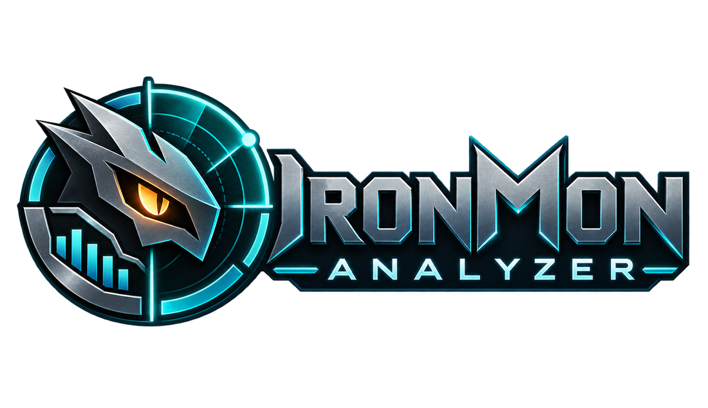
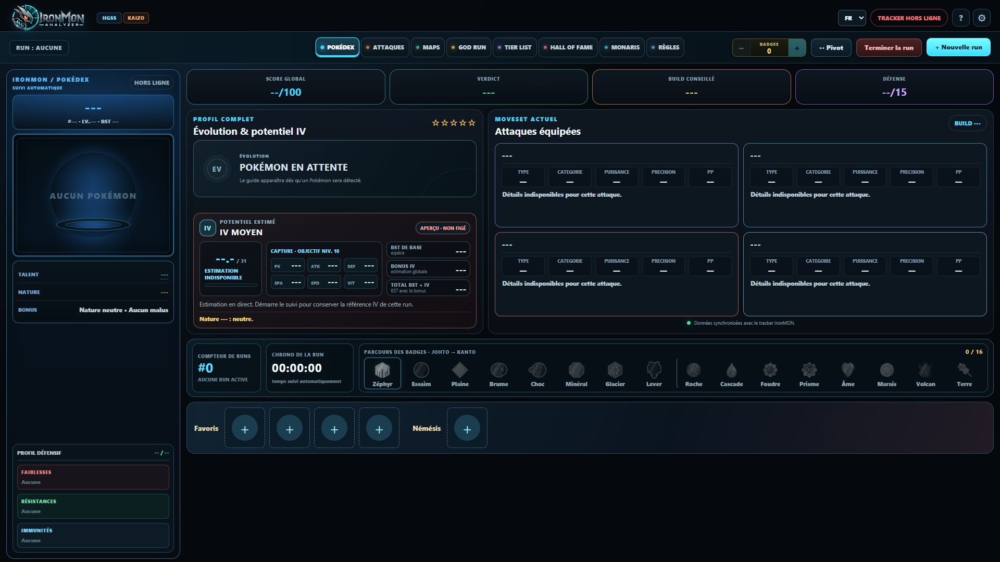
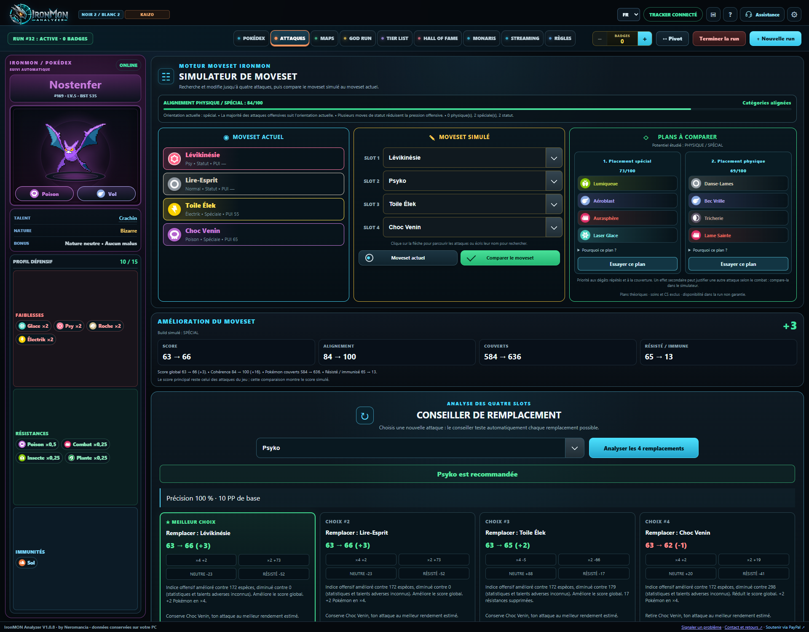
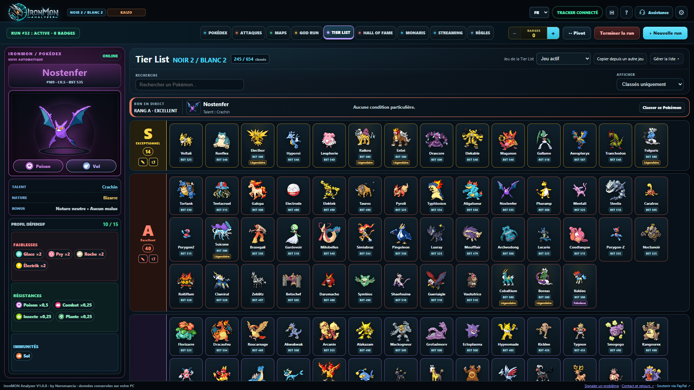
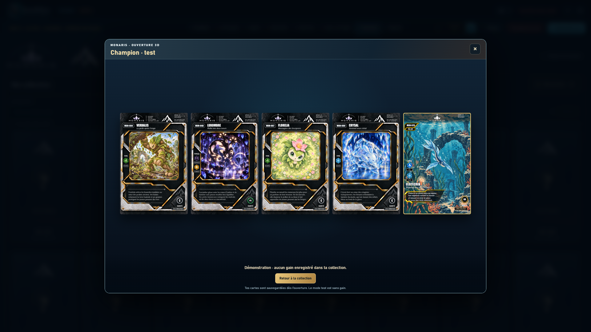

[Français](README.md) | [English](README.en.md)

  

# IronMON Analyzer — V1.0.10

**A free companion for your IronMON runs, developed by Neromancia.**

Track your Pokémon, compare movesets, explore maps and keep a record of your adventures in a Windows application that runs on your PC.

**[Official website and download](https://ironmonanalyzer.com/index.en.html) · [Installation guide](https://ironmonanalyzer.com/guide.en.html) · [Contact](mailto:contact.ironmonanalyzer@gmail.com)**

## Version 1.0.10 — publication in preparation

Version 1.0.10 improves French and English move search, adds central reset and pivot confirmations, and refreshes the interface. Assistance and the tutorial now cover Nintendo DS/GBA trackers, languages, patches and switching games. Early Platinum IV references advance to level 10; later pivots retain their first real measurement, including level-11 Black 2 / White 2 pivots and level-23 Platinum pivots. This update does not install ROM patches or personal tracker modifications.

**[Download the current version](https://ironmonanalyzer.com/index.en.html) · [Full release notes](https://ironmonanalyzer.com/release-notes.en.html)**

## Your run, in one place

- **Pokédex and profile analysis**: stats, IV estimates, ability, nature, weaknesses and an explained verdict.
- **Moveset advisor**: simulate a moveset and compare suggestions based on stats, abilities, coverage and the rules of your chosen mode.
- **Interactive maps**: HGSS, Sinnoh, Black / White, Black 2 / White 2, Kanto (FireRed) and Hoenn (Emerald), with markers, filters, correction tools and annotations.
- **Progress tracking**: runs, badges, timer, favorites, GOD RUN, tier lists and Hall of Fame.
- **Monaris**: a small reward for your progress. Reach milestones during your runs, earn booster packs and discover collectible cards… with more to come.
- **OBS streaming**: a scene template or separate blocks, customization and a preview before saving.
- **An interface that fits your play**: French and English, a reduced layout, a getting-started tutorial and tracker connection assistance.

### Pokédex — a live run

### Moves — compare before choosing

### Tier List — your personal rankings

## Games and installation

Public version 1.0.10 supports **Pokémon HeartGold / SoulSilver, Platinum, Black / White, Black 2 / White 2, FireRed and Emerald**.

Nintendo DS games use the NDS IronMON Tracker. FireRed and Emerald use Besteon’s GBA tracker with the Analyzer extension. Your game language and patches must be compatible with the tracker you choose; see the guide.

It runs on **64-bit Windows**, with BizHawk and a compatible tracker configured as described in the guide. Analyzer's installer does not require Python, Git or Codex. No game or ROM is included. There is no mobile or tablet version.

1. Set up your emulator, game and tracker using the [guide](https://ironmonanalyzer.com/guide.en.html).
2. Download and install Analyzer from the [official website](https://ironmonanalyzer.com/index.en.html).
3. Connect your tracker in the application and start your run.

## Your data stays on your PC

Runs, Hall of Fame entries and your Monaris collection are stored in your local profile. The application includes a backup option for this data. Personal map corrections are saved in the browser you use and are separate from the profile backup.

The website counts download starts in aggregate; this number does not represent unique users or completed installations. See the [credits and privacy notice](https://ironmonanalyzer.com/credits-confidentialite.en.html) for details.

## Help with decisions

Scores and suggestions compare profiles and moves. They cannot account for every upcoming battle: a theoretical plan does not guarantee that you will obtain its moves during a run or have a safe opportunity to set up. Feedback from actual runs helps improve this reasoning.

## Monaris

Discover cards as you progress. Their use and sharing are described in the [Monaris terms](https://ironmonanalyzer.com/monaris-rights.en.html).

## Feedback and future updates

An inconsistent move suggestion, a map error or an idea for an improvement? Email [contact.ironmonanalyzer@gmail.com](mailto:contact.ironmonanalyzer@gmail.com) with your version, game, mode and the steps needed to reproduce the issue. Please do not attach ROMs or personal information.

Planned areas of improvement are listed in the [roadmap](ROADMAP.en.md). Priorities will evolve with your feedback.

## Support the project

[Support via PayPal](https://paypal.me/ironmonanalyzer) is optional. It helps cover website hosting, downloads and development tools. The application remains free, with no gameplay benefits reserved for donors.

---

**by Neromancia** · An independent project, not affiliated with Nintendo, Game Freak or The Pokémon Company.

This public repository presents the application; Analyzer's source repository remains private. Third-party credits and licenses are listed in the application and on the website. Third-party resources and Monaris remain subject to their respective rights and terms.
