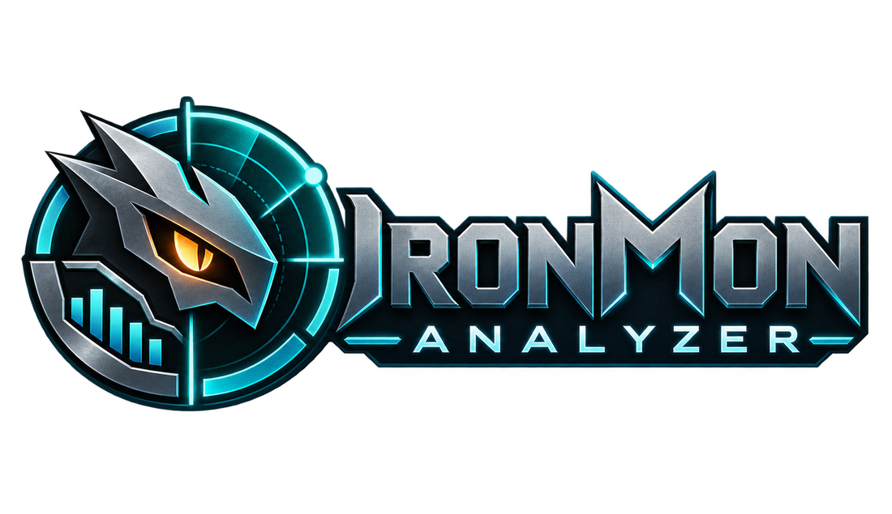
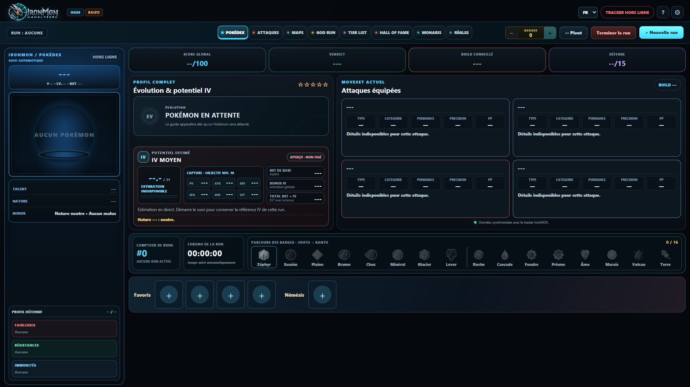
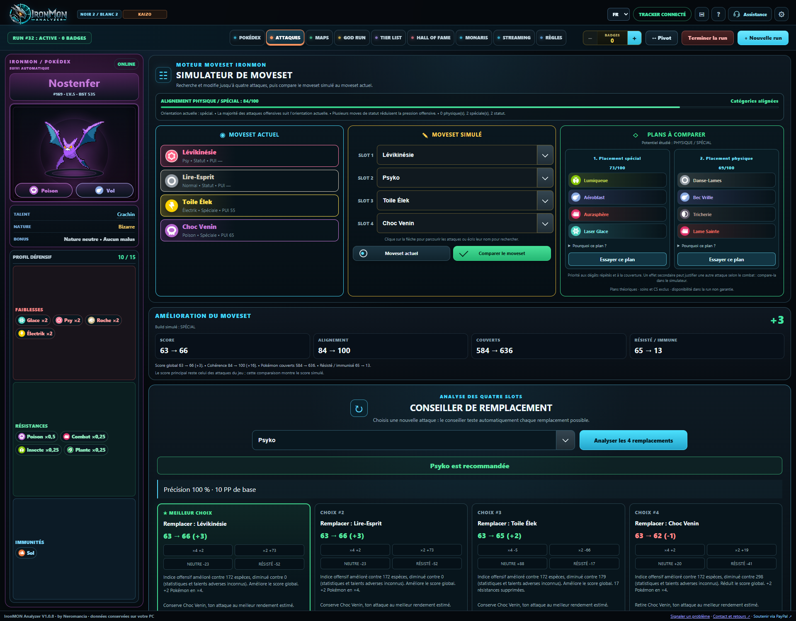
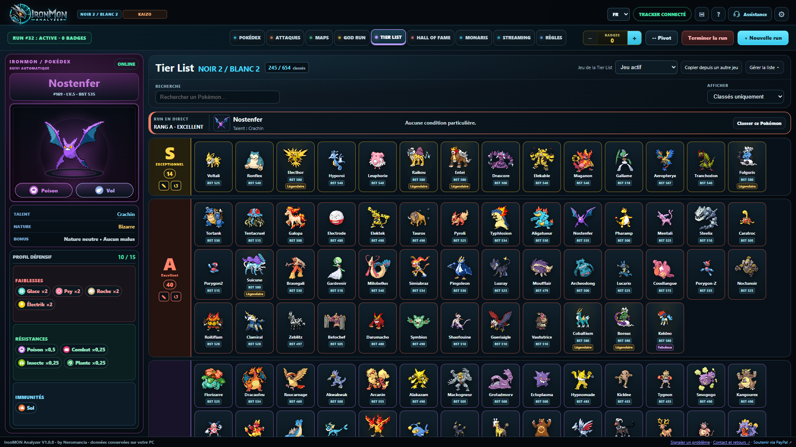
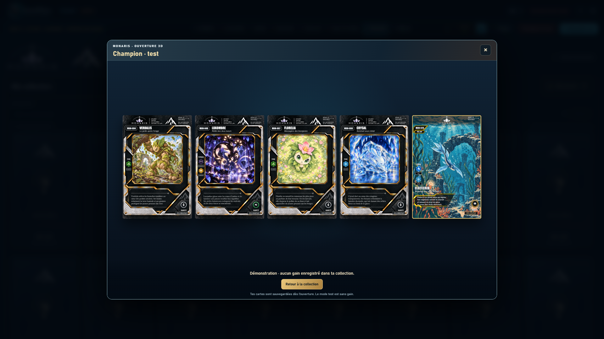

[Français](README.md) | [English](README.en.md)

  

# IronMON Analyzer — V1.0.10

**Un compagnon gratuit pour vos runs IronMON, développé par Neromancia.**

Suivez votre Pokémon, comparez vos attaques, explorez les cartes et gardez une trace de vos aventures dans une application Windows qui fonctionne sur votre PC.

**[Site officiel et téléchargement](https://ironmonanalyzer.com/) · [Guide d’installation](https://ironmonanalyzer.com/guide.html) · [Contact](mailto:contact.ironmonanalyzer@gmail.com)**

## Version 1.0.10 — publication en préparation

La 1.0.10 améliore la recherche des attaques en français et en anglais, ajoute les confirmations centrales de reset et de pivot, et harmonise l’interface. L’assistance et le tutoriel sont actualisés pour les trackers Nintendo DS/GBA, les langues, les patches et les changements de jeu. Les IV des pivots précoces sur Platine se précisent jusqu’au niveau 10 ; les pivots tardifs conservent leur première mesure réelle, notamment au niveau 11 sur Noir 2 / Blanc 2 et au niveau 23 sur Platine. Aucun patch de ROM ni tracker personnel modifié n’est installé par cette mise à jour.

**[Télécharger la version actuelle](https://ironmonanalyzer.com/) · [Toutes les notes de version](https://ironmonanalyzer.com/release-notes.html)**

## Votre run, au même endroit

- **Pokédex et analyse du profil** : statistiques, estimation des IV, talent, nature, faiblesses et verdict expliqué.
- **Conseiller d’attaques** : simulation d’un moveset et comparaison de propositions selon les statistiques, les talents, la couverture et les contraintes du mode choisi.
- **Cartes interactives** : HGSS, Sinnoh, Noir / Blanc, Noir 2 / Blanc 2, Kanto (Rouge Feu) et Hoenn (Émeraude), avec repères, filtres et outils de correction et d’annotation.
- **Suivi de progression** : runs, badges, chrono, favoris, GOD RUN, tier lists et Hall of Fame.
- **Monaris** : une petite récompense pour vos progrès. Franchissez des étapes pendant vos runs, gagnez des boosters et découvrez des cartes à collectionner… et bien plus à venir.
- **Streaming OBS** : modèle de scène ou blocs séparés, personnalisation et aperçu avant enregistrement.
- **Confort d’utilisation** : interface en français et en anglais, mode réduit, tutoriel de prise en main et assistance pour connecter le tracker.

### Pokédex — une run en cours

### Attaques — comparer avant de choisir

### Tier List — votre classement personnel

## Jeux et installation

La version publique 1.0.10 accompagne **Pokémon HeartGold / SoulSilver, Platine, Noir / Blanc, Noir 2 / Blanc 2, Rouge Feu et Émeraude**.

Les jeux Nintendo DS utilisent le NDS IronMON Tracker. Rouge Feu et Émeraude utilisent le tracker GBA de Besteon avec l’extension Analyzer. La langue et les patches du jeu doivent être compatibles avec le tracker choisi ; consultez le guide.

Elle s’utilise sur **Windows 64 bits**, avec BizHawk et le tracker compatible configurés selon le guide. L’installateur d’Analyzer ne demande pas d’installer Python, Git ou Codex. Aucun jeu ni ROM n’est fourni. Il n’existe pas de version mobile ou tablette.

1. Préparez l’émulateur, le jeu et le tracker en suivant le [guide](https://ironmonanalyzer.com/guide.html).
2. Téléchargez et installez Analyzer depuis le [site officiel](https://ironmonanalyzer.com/).
3. Connectez le tracker dans l’application et lancez votre run.

## Vos données restent sur votre PC

Les runs, le Hall of Fame et la collection Monaris sont conservés dans le profil local. L’application propose une sauvegarde de ces données. Les corrections personnelles des cartes sont enregistrées dans le navigateur utilisé et sont distinctes de cette sauvegarde de profil.

Le site compte les départs de téléchargement de façon agrégée ; ce nombre ne correspond pas au nombre d’utilisateurs ou d’installations terminées. Consultez les [crédits et la confidentialité](https://ironmonanalyzer.com/credits-confidentialite.html) pour les détails.

## Une aide pour décider

Les scores et les propositions comparent des profils et des attaques. Ils ne connaissent pas tous les combats à venir : une proposition théorique ne garantit ni l’obtention des attaques pendant la run, ni la possibilité de placer un boost sans risque. Les retours de parties servent à améliorer ce raisonnement.

## Monaris

Les cartes se découvrent au fil de votre progression. Leur utilisation et leur partage sont décrits dans les [conditions Monaris](https://ironmonanalyzer.com/monaris-droits.html).

## Retours et prochaines évolutions

Un conseil d’attaque incohérent, une erreur sur une carte ou une idée d’amélioration ? Écrivez à [contact.ironmonanalyzer@gmail.com](mailto:contact.ironmonanalyzer@gmail.com), avec la version, le jeu, le mode et les étapes pour reproduire le problème. Évitez de joindre une ROM ou des informations personnelles.

Les pistes envisagées figurent dans la [feuille de route](ROADMAP.md). Elles évolueront avec vos retours.

## Soutenir le projet

Le [soutien via PayPal](https://paypal.me/ironmonanalyzer) est facultatif. Il aide à financer l’hébergement du site, les téléchargements et les outils de développement. L’application reste gratuite, sans avantage de jeu réservé aux donateurs.

---

**by Neromancia** · Projet indépendant, non affilié à Nintendo, Game Freak ou The Pokémon Company.

Ce dépôt public présente l’application ; le dépôt source d’Analyzer reste privé. Les crédits et licences des composants tiers sont indiqués dans l’application et sur le site. Les ressources tierces et Monaris restent soumis à leurs droits et conditions propres.
